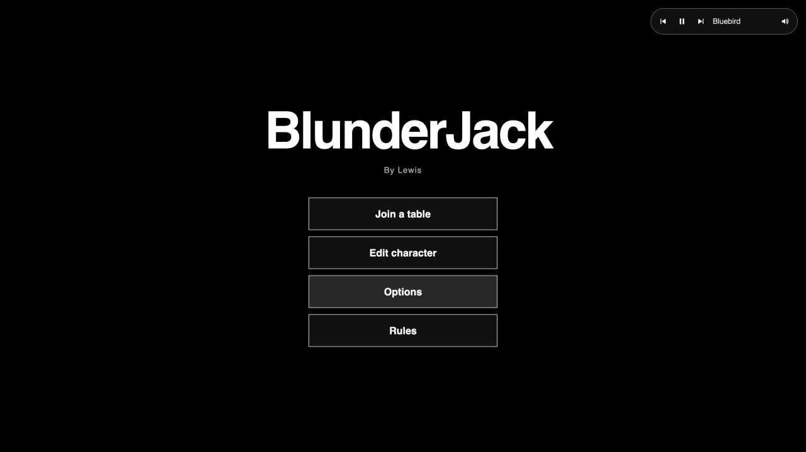
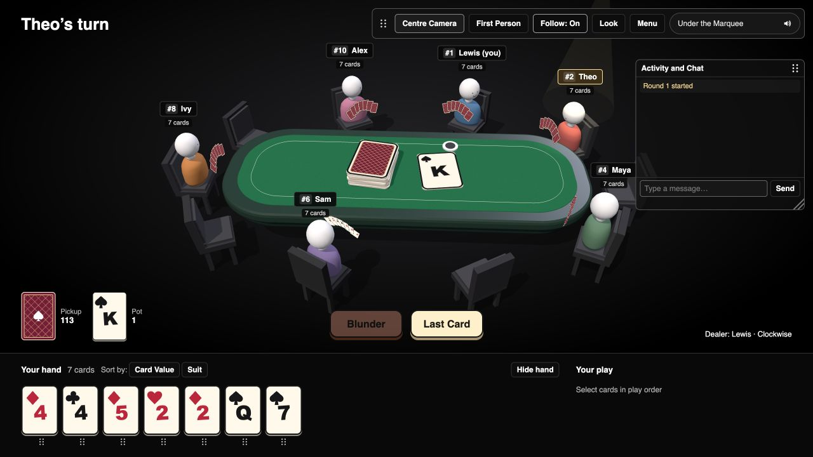
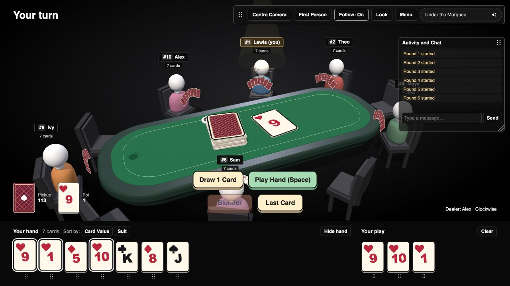
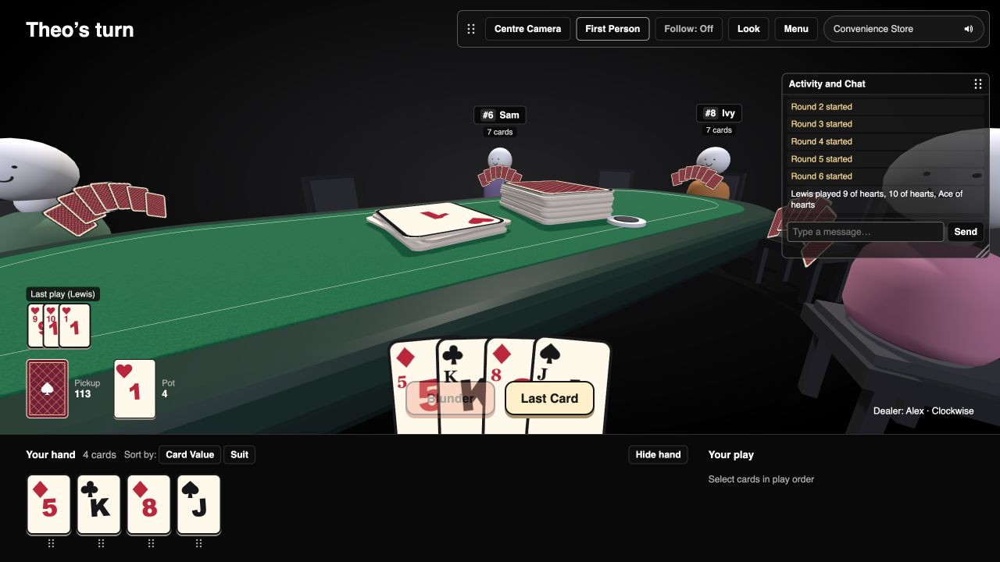

# BlunderJack

**Chain your cards, bluff your way out, and call BLUNDER when someone pushes their luck.** BlunderJack is a multiplayer shedding game for 2–10 players, played around a shared table in a desktop window or browser.

- Build chains, turn the tables with special cards, and challenge a suspicious play.
- Play with friends, practice against six bot styles, or run fast bot simulations.
- Make a character, chat, use emotes, and take in the table from first person.
- Host on Windows, macOS, or Linux; friends can join on your network in a browser.

[**Download a release**](https://github.com/mrlewismharris/blunderjack-game/releases) · [Get playing](#get-playing) · [Build from source](#build-from-source) · [Rules](#rules-and-reference)


*Create your character and find a table.*


*Gather around the table with friends and bots.*


*Build a chain and decide when to call BLUNDER.*


*See the action from your own seat.*

## Get playing

Download and extract the archive for your operating system from [Releases](https://github.com/mrlewismharris/blunderjack-game/releases). The host runs the server; each player can use the desktop client or a browser. Keep the server running during play.

### Windows

Download `blunderjack-windows-x64.zip` and extract it. Keep `WebView2Loader.dll` alongside `blunderjack-client.exe`; the client needs the [Microsoft Edge WebView2 Runtime](https://developer.microsoft.com/en-us/microsoft-edge/webview2/). Run `blunderjack-server.exe`, then open `blunderjack-client.exe` to play on the host computer. From PowerShell in the extracted folder:

```powershell
.\blunderjack-server.exe
# In a second PowerShell window:
.\blunderjack-client.exe
```

### macOS

Download `blunderjack-macos-arm64.tar.gz` for Apple Silicon or `blunderjack-macos-x64.tar.gz` for Intel and extract it. In Terminal, change into the extracted folder and run:

```sh
chmod +x blunderjack-server blunderjack-client
./blunderjack-server
```

Open a second terminal in the same folder and run `./blunderjack-client`. The macOS executables are unsigned. If macOS blocks a release binary you trust, follow Apple’s [instructions for opening an unidentified developer’s app](https://support.apple.com/en-gb/guide/mac-help/mh40617/mac), or build it locally using the source instructions below.

### Linux

Download `blunderjack-linux-x64.tar.gz` and extract it. On Ubuntu 22.04 or newer, install the desktop runtime dependencies:

```sh
sudo apt update
sudo apt install libwebkit2gtk-4.1-0 libxdo3 gstreamer1.0-plugins-base gstreamer1.0-plugins-good
```

In the extracted folder, run:

```sh
chmod +x blunderjack-server blunderjack-client
./blunderjack-server
```

Open a second terminal in the same folder and run `./blunderjack-client`.

### Join and start

Create a character and choose **Join a table**. On the host computer, enter `127.0.0.1`; other players enter the host's LAN IP address. The default port is `8765`. A browser player needs no desktop installation: open `http://<host-IP>:8765`, or [http://127.0.0.1:8765](http://127.0.0.1:8765) on the host.

For play across your home network, allow incoming TCP port `8765` through the host’s firewall. The browser fills in its host server address automatically.

Choose a seat. Once at least two players are seated (a bot counts), type `game_start` in the server console to deal the first round. For example, add a bot with `bot_add 2` if seat 2 is open. See [hosting and controls](#hosting-and-controls) for more commands.

## Build from source

Use the source build for the newest changes on the main branch. Release archives contain the features available when that release was published.

Install [Rust stable and Cargo](https://rust-lang.org/learn/get-started/) and Git first. Windows builds require the MSVC C++ build tools. On macOS, install the compiler tools with `xcode-select --install`. Linux builds need the development packages below plus the GStreamer runtime plugins listed above. On Ubuntu:

```sh
sudo apt install build-essential pkg-config libgtk-3-dev libwebkit2gtk-4.1-dev libxdo-dev
```

Then clone and build:

```sh
git clone https://github.com/mrlewismharris/blunderjack-game.git
cd blunderjack-game
cargo build --release --locked --bins
```

Start the built server and client in separate terminals:

```sh
# macOS / Linux
./target/release/blunderjack-server
# In a second terminal:
./target/release/blunderjack-client
```

```powershell
# Windows PowerShell
.\target\release\blunderjack-server.exe
# In a second terminal:
.\target\release\blunderjack-client.exe
```

The executables are in `target/release`. To run from Cargo, use `cargo run --bin blunderjack-server` and `cargo run --bin blunderjack-client` in separate terminals. With the Windows GNU toolchain, have MinGW `dlltool` and `as` on `PATH`. When distributing a GNU desktop build, copy the matching `WebView2Loader.dll` from the `webview2-com-sys` build output to the client executable’s folder.

The Three.js runtime and its [MIT license](client/vendor/THREE-LICENSE.txt) are vendored under `client/vendor`.

The Jack, Queen, and King use original monochrome pictograms. See the [artwork license](client/cards/ARTWORK-LICENSE.txt).

## Rules and reference

<details>
<summary><strong>Rules at the table</strong></summary>

### Rules at the table

- Each player starts with seven cards. The table uses two decks for 2–4 players, three for 5–7, and four for 8–10. The dealer moves clockwise each round. The first player is the next occupied seat clockwise from the dealer.
- Match the POT by suit or rank, or lead with an Ace. The Ace displays as 1. The illustrated Jack, Queen, and King count as 11, 12, and 13. Within a chain, match rank to change suits or move one rank up or down in the same suit. An Ace inside the chain must match suit. The card after an Ace in the same chain must be a King or 2 of its suit.
- Only the last card activates a special effect. Count consecutive matching special cards at the end for 2s, Queens, or black Jacks. An 8 reverses direction. Queens skip one turn each. Each 2 adds two cards to the pending pickup, which the next player can pass on by playing more 2s. A new black-Jack penalty starts at seven per black Jack. A black Jack played in response doubles the outstanding amount per card. A single red Jack cancels the entire black-Jack penalty.
- Drawing ends the turn. If the PICKUP empties, the older POT cards become the new PICKUP in the same order, with the current top card left in place. A player who fails to reconnect within 20 seconds returns their hand to the bottom of the PICKUP.
- Drag or use the arrows to reorder your hand or staged play. Click cards to select them, then click **Play Hand (Space)** or press Space. Other players see the cards go onto the POT in order.
- Another player in the round can call **BLUNDER** once before the next turn is taken. The table pauses briefly for the ruling. If the play was illegal, the offender takes back the cards and draws two. If the play was legal, the caller draws two. Unchallenged illegal plays stand. A finishing play must be legal and has an eight-second challenge window after its reveal.
- When you play down to one card, click **Last Card** before someone places another card or calls **BLUNDER**. If a legal play is challenged and you missed the call, take back the last card you placed and draw one. If you called it, the challenger draws one. An unchallenged missed call carries no penalty.

</details>

<details>
<summary><strong>Hosting, controls, bots, and administration</strong></summary>

## Hosting and controls

Type `game_restart` in the server console to end the current round and deal a fresh hand immediately to the connected players in their seats. This also requires at least two players. Between completed rounds, the usual five-second countdown applies. A player taking a seat during a round watches until the next deal.

The server console shows connections, seat changes, turns, plays, draw counts, BLUNDER calls and rulings, and round results.

Type `password_set "your password"` in the server console to require a password for new connections and reconnects. Type `password_set ""` to remove it. Players already connected can keep playing. The password lasts until the server restarts. Use `wss://` if the password needs to be encrypted in transit.

Hold `Tab` at the table to see first-, second- and third-place finishes, losses, and estimated one-way ping. A round continues until the podium is decided. If only one player remains, they take the next available place. Completed-game scores are saved across server restarts. Ping is half the server’s measured round-trip time.

### Playing with bots

Use `bot_add 2` in the server console to add a greedy bot to seat 2, or choose a style with `bot_add 2 defensive`; use `bot_remove 2` to remove it. Seat numbers run from 1 to 10. Occupied seats, including disconnected players' reserved seats, cannot be replaced, and `bot_remove` cannot remove a human. Verified admins can use the same commands in chat as `/bot_add 2` and `/bot_remove 2`.

Bots count toward the two-player minimum, so you can play against one bot or watch a table of bots. Use `game_start` for the first deal as usual. Bots added during a round join the next deal; removing an active bot returns its cards and advances the game normally. Wait for any pending Blunder ruling before removing a bot.

Bots play legal card chains using their own hand and the public table, draw when they cannot play, and call Last Card. They respect dealing and reveal animations and the finishing challenge window. These simple bots do not bluff or call Blunder. Bots remain seated between rounds but are not saved across server restarts.

### Quick mode and bot analysis

`quick_mode on` removes dealing, card reveals, bot thinking delays, the finishing challenge window, and between-round countdowns; connected clients also skip game animations. `quick_mode off` restores normal timing. Quick mode is intended for simulations: there is no finishing-play Blunder window while it is enabled.

The optional final argument to `bot_add <seat> [style]` selects one of these styles; omitted styles default to `greedy`:

| Style | Approach |
| --- | --- |
| `greedy` | Shed the longest legal chain found. |
| `aggressive` | Prefer chains ending in penalties and skips. |
| `defensive` | Conserve Aces and red Jacks for later responses. |
| `suit_control` | Prefer ending in a suit still held in the hand. |
| `tactical` | Value specials and reversals when the next player is close to finishing. |
| `random` | Sample legal plays as a comparison baseline. |

`start_bot_analysis` refuses to run while any human holds a seat. It replaces existing bots with ten bots covering all six styles, enables quick mode, and immediately starts continuous games. Seat assignments are shuffled each round and the four extra style slots rotate, giving every style the same number of entries over six completed games. During analysis, humans can watch but cannot take seats, and bot changes or turning quick mode off require `stop_analysis` first.

`stop_analysis` stops the simulation, removes its bots, turns quick mode off, and prints the cumulative statistics overview. The unfinished game is discarded. Calling it when analysis is not running leaves the current game alone. `stats` prints the same overview at any time. Verified admins can use all these commands in chat with a leading `/`; replies are private.

Statistics include completed-game counts, each player/bot name's 1st/2nd/3rd places, and style win/podium rates with their entry counts. Ordinary play and analysis style rankings are kept separate. Names are grouped by persistent client ID for humans and by seat/style for bots; using the same client ID in multiple seats records one entry per occupied seat. Confirmed places in an unfinished game appear on the live scoreboard, but only completed games enter persistent statistics.

The server writes `blunderjack-stats-<port>.json` in its working directory after every completed game. Keep that file and use the same directory and port across restarts. Statistics reload automatically, including a returning player's scoreboard totals; quick mode and analysis themselves start disabled. An interrupted game is not resumed. The rankings describe these particular legal-play strategies and matchups; bots do not bluff or call Blunder, so the results do not measure their ability to detect human bluffs.

### Console pranks

Type `prank_help` to list the commands. Pass a seated player's name in quotes, as in `grow_head "John Smith"`, or use their seat number, as in `grow_head 3`. Seat numbers do not need a `#` prefix, although the old form still works. Quote a numeric username to target it by name. Everyone at the table sees the effect for a few seconds.

| Command | Effect |
| --- | --- |
| `grow_head` | Inflates the player's head, then shrinks it back. |
| `tiny_head` | Shrinks the player's head. |
| `spin_chair` | Spins the player and chair together. |
| `bounce` | Makes the player bounce in their seat. |
| `disco` | Cycles through sweater colours. |
| `pancake` | Squashes the player flat and wide. |
| `bomb` | Sends a cartoon plane over the table to drop a mushroom cloud on the target. |
| `teabag 1 3` | Makes the first player hop around the table, bounce on the second player's head, and return to their chair. |

Use **Activity and Chat** to talk to everyone at the table. Type `/prank_help` to see the available chat commands. Commands like `/grow_head` affect your character. Use `/bomb 3` or `/teabag 3` to target another player by the seat number beside their name.

### Chat administration

1. Connect over localhost, or use a `wss://` connection for remote administration. In a remote browser, open the game over HTTPS as well.
2. Type `player_list` in the server console to list all connected players, their connection IP addresses, and client IDs. Players can also type `/id` in chat to see their own ID. The ID persists in the client profile for that server address.
3. In the server console, run `admin_add <client ID>`. Use `admin_list` to list administrators and `admin_remove <client ID>` to revoke access. The server saves these IDs in `blunderjack-admins-<port>.txt` in its working directory.

Admins can run any server console command directly in chat with a leading `/`, including `/player_list`, `/bot_add <seat>`, `/bot_remove <seat>`, `/admin_add <client ID>`, `/admin_remove <client ID>`, `/admin_list`, `/game_start`, `/game_restart`, and `/password_set "password"`. Targeted pranks accept the same player names or seat numbers as the console, for example `/grow_head 3` or `/teabag 1 3`. Existing self-pranks and the single-target `/teabag <seat>` shortcut still work, and the `/admin <command>` prefix remains supported. Replies, including player IP addresses, appear only in the requesting admin's activity log. Plain remote WebSocket connections receive an unverified player ID and can use regular chat and pranks.

The listed IP is the server's direct connection peer, so deployments behind a reverse proxy show the proxy's address. Older clients without identity support are listed with an unavailable client ID and cannot receive admin access.

Drag the table to orbit, middle-drag to pan, and scroll to zoom. The camera follows the active player by default. Use **Centre Camera** to see the whole table or turn **Follow** off to keep your own angle. Drag the floating controls by their handle to move them, and press `Esc` to open the table menu. When the table has keyboard focus, use the arrow keys to look around, `+` and `-` to zoom, and `Home` to centre the camera.

While seated, choose **First Person** to see your cards fanned out in front of you. With **Follow** on, the camera turns toward the active player from your seat and looks toward the table on your turn. Set the field of view in **Options** and hold `Shift` to zoom in. Other players can see your character turn as you look around. Choose **Look** and click another player to face them for five seconds. Press `Ctrl+Shift+E` to pick an emoji to show above your character. Drag the handle under a card to reorder your hand.

For a local two-player test, open `blunderjack-client.exe` twice and join `127.0.0.1` in each window. You can also join from a browser at `http://127.0.0.1:8765`.

To listen on a different address or port, pass it to the server, for example `blunderjack-server.exe 127.0.0.1:9000`. Players then enter `127.0.0.1:9000`.

The server shuffles and deals the cards, accepts plays only from the current player, and sends each hand only to its owner. Direct IP connections use plain WebSocket. For encrypted connections, put the server behind a TLS reverse proxy that forwards `/ws` and enter the proxy’s `https://` or `wss://` address in the client.

</details>
